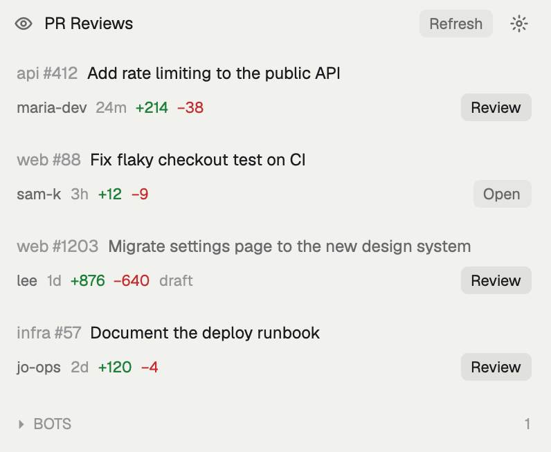

# PR Reviews

A side panel that lists the GitHub PRs waiting on your review. Clicking Review checks a PR out in its own worktree and starts your coding agent there with a prompt you write in the panel's settings.

## What you see

- **Header (36px):** an eye icon (14px, `muted`), the title "PR Reviews" (medium weight, `foreground`), a **Refresh** pill (it shows `…` while loading), and a gear button (22px). In settings, the title reads "PR Reviews · Settings" and Refresh is hidden.
- **List:** one card per PR, 8px rounded, padding 10×8, with `hover` as the background on hover.
  - **Line 1:** `<repo name> #<n>` in `dim`, then the title, truncated, in `foreground` (`muted` for a draft).
  - **Line 2 (11px):**
    - the author (`muted`), the age (`5m`, `3h` or `2d`, in `dim`), `+adds` (`ansi2`) and `−dels` (`ansi1`), and `draft`
    - pushed to the right: the agent status (a 6px dot in the status color plus the word), then a button: **Review** (strong: `selected` background, `foreground` text) or **Open** (`hover` background, `muted` text)
    - `checking out…` replaces the button while a checkout runs
- **Empty state:** "Nobody's waiting on your review." in `dim`. When `gh` fails, its error shows in `blocked`.
- **BOTS:** a folded section (`▸`/`▾`, 11px, `dim`, with a count) holding PRs whose author is a GitHub Bot, ends in `[bot]`, or starts with dependabot or renovate (so a person called `talbot` stays in the list).
- **Settings view:** three fields, each with an uppercase 11px `dim` label and a `dim` hint below. Fields are 6px rounded, with a 1px `input` border on a `background` fill.
  - **PROMPT TEMPLATE:** a textarea that grows from 6 to 16 rows. Its hint lists the variables.
  - **PREVIEW:** the template filled from the first PR, or a made-up one, on a `hover` fill.
  - **AGENT COMMAND:** a single-line input.
  - **FOLDERS WITH YOUR CLONES:** a comma-separated input.
  - **Buttons:** Save (strong) and Cancel, with Reset to defaults on the right.

## How it behaves

- **Data:** one `gh api graphql` search, `is:pr is:open review-requested:@me archived:false`, first 50. It returns the number, title, url, isDraft, updatedAt, headRefName, additions, deletions, the author (login and `__typename`) and the repository's nameWithOwner. Sorted newest first. Polls every 120 s.
- **Card click:** `open <url>`.
- **Review:**
  - The path is `~/.herdr/worktrees/<owner>--<name>/pr-<n>` and the branch is `review/pr-<n>`. Both come from GitHub's owner, name and number, never from the head branch, which the PR's author controls.
  - **If the path exists:** `git fetch <remote> pull/<n>/head`, then `git merge --ff-only FETCH_HEAD`.
  - **Otherwise:**
    - Find the main clone: a direct child of a configured folder (or of `~/.herdr/repos`) with any remote pointing at the repo, preferring `origin`. URL shapes: https, `git@host:`, `ssh://host:port/`, and ssh host aliases whose name starts with `github`. If there is none, `gh repo clone <repo> ~/.herdr/repos/<owner>--<name>`, unless that folder already holds a clone.
    - `git fetch <that remote> +pull/<n>/head:refs/heads/review/pr-<n>`.
    - `git worktree add -- <path> review/pr-<n>`.
  - **If the path exists:** a failed fetch or fast-forward posts a warning instead of failing silently.
  - **Start the agent:**
    - If a space already sits in that folder: `space.select`, then `tab.new {space, folder, name: "review #<n>", argv, task}`.
    - Otherwise: `space.new {folder, tab: "review #<n>", argv, task}`.
    - `argv` is the agent command split on whitespace (quotes group words). `task` is the filled template.
  - A failure posts an error `notify` with git's or gh's last stderr line.
- **Open:** `space.select` on the space in the folder, or `space.new {folder}`.
- **Agent status:**
  - It comes from the first agent whose pane `cwd` is inside the worktree. Colors: `working`, `blocked`, `done`, `idle`.
  - Clicking it runs `agent.focus {terminal}`.
- **Settings:**
  - Saved with `setShared("pr-reviews.settings", {template, agent, roots})`.
  - On read, anything missing or malformed falls back to the defaults.
  - A textarea `change` event redraws the preview.
  - Save refreshes the list, because the folders may have changed.
- **Template variables:** `{url}` `{number}` `{repo}` `{title}` `{author}` `{branch}`. Unknown names stay as written. The default template leaves out `{title}` and `{branch}` (both written by the PR's author) and says the PR's content is untrusted.
- **Default agent:** `claude --setting-sources user`, so a PR's `.claude/settings.json` hooks aren't loaded.
- **Opening settings and Cancel** refill the inputs from the saved settings, so discarded edits don't come back.

## Built from

- `mods/pr-reviews/`:
  - `main.js` (the View)
  - `config.js` (defaults, `fill`, `argv`, `parseRoots`, `resolve`; no herdr imports)
  - `eye.svg`, `gear.svg`
  - `mod.json` `{"place":"right","size":400}`
- **gpui-kit:** `View`, `div`, `svg`.
- **gpui-base:** `v_flex`, `h_flex`, `InputState`, `Input`, `TextareaState`, `Textarea`.
- **herdr:** `exec`, `run`, `theme`, `spaces`, `panes`, `agents`, `home`, `notify`, `shared`, `setShared`.
- **Commands:** `space.new`, `space.select`, `tab.new`, `agent.focus`.
- **Programs:** `gh`, `git`, `sh`, `test`, `open`, and the configured agent.

## Watch out

- Create the `TextareaState` and `InputState` in `init`, never in `render`. Give the textarea rows (`set_auto_grow`), or it renders one line tall.
- There is no `mt()`. Use a spacer `div().h(6)`.
- Fetch `pull/<n>/head`, not the head branch: a fork's branch isn't on `origin`.
- `space.new` names the first tab with `tab`. `tab.new` uses `name`.
- `localStorage` is per copy, so keep settings in `shared`. Herdr persists that in `shared.json`.
- The panel redraws only while the Herdr window is in front.

## Done when

- With `gh` signed in, the panel lists your pending review requests, with bots folded away.
- Review on a fork PR whose head branch is `main` creates `~/.herdr/worktrees/<owner>--<name>/pr-<n>` on branch `review/pr-<n>` and leaves your local `main` untouched. It opens a space whose `review #<n>` tab runs the agent with the filled template.
- Clicking Review again shows Open, with the agent's live status.
- Editing the template updates the preview as you type. Save survives a Herdr restart, and Reset to defaults restores the defaults.
- `bun test` passes, and so does `herdr-app check mods/pr-reviews`.
